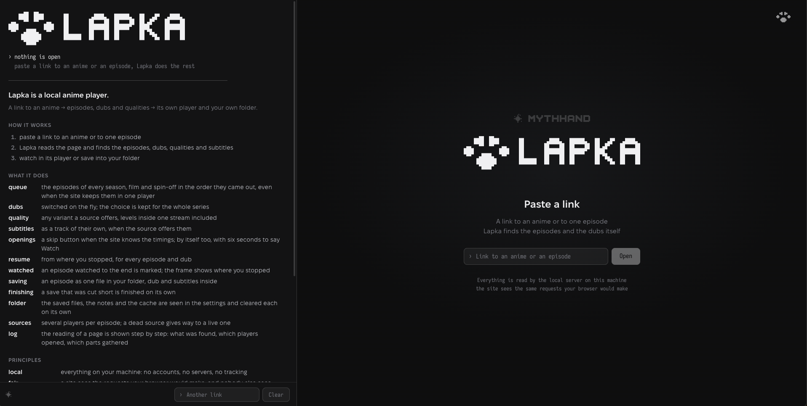
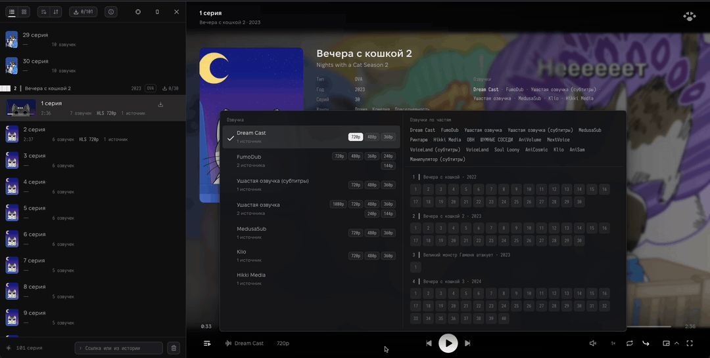

<p align="center">
  <picture>
    <source media="(prefers-color-scheme: dark)" srcset="docs/media/l_bl.gif">
    
  </picture>
</p>

# Lapka

A local player. Paste a link to a video, a series or a single episode: Lapka
reads the page, finds the episodes, dubs, qualities and subtitles, and shows
it all in its own player. Episodes follow one another, the dub you chose is
kept for the whole series, and any episode can be saved as one file into your
own folder.

Everything runs on your machine: a small Node.js server reads the site's
pages with the same requests your browser would make and hands the video to
your browser. Nothing is proxied outward, there are no accounts and no
library in a cloud.

Idea, design and hands-on testing: Dimbo. The code is written together with
Claude in Claude Code.

Lapka grew out of [PIP-Player](https://github.com/MythHand/PIP-Player), a local
player by the same author under the MIT licence. Its code was reworked freely
and, as part of Lapka, goes under Lapka's licence; in its original form it
stays available in the PIP-Player repository under MIT. The MIT notice is kept
in [LICENSES/PIP-Player.MIT.txt](LICENSES/PIP-Player.MIT.txt).



## What it does

- **Queue.** The episodes of every season, film and spin-off of a franchise, in the order they came
  out, even when the site keeps every season in one player.
- **Dubs.** Switched on the fly, without a reload; the choice is kept for the whole franchise,
  and another season starts in it.
- **Dubs by part.** A map of parts × episodes, at a button in the queue's header and in the dub
  menu: which episodes have which dubs; hovering lights them up.
- **Quality.** Any variant a source offers, the levels inside one stream included.
- **Subtitles.** As a track of their own, when the source offers them; their look is adjustable.
- **Openings.** A skip button when the site knows the timings; by itself too, with six seconds to
  say Watch.
- **Resume.** From where you stopped, for every episode, whatever the dub; an episode watched to
  the end is marked, the frame shows where you stopped, and the timeline shows what is already
  on the disk.
- **Pause.** On pause the frame shows the series: cover, year, kind, episode count, genres, studio,
  source material, age rating and the dubs of this part. Switched off in the settings.
- **History.** The links you pasted, at hand: the link field in the queue's footer opens the history
  on focus and searches it, by title or address; on the right, the parts of the franchise with their
  cover, year and episode count. Each link says where you stopped and opens from there; a link you
  no longer want is removed from the list.
- **Saving.** An episode as one file in your folder, with the chosen dub and the subtitles inside.
  Saves go in a queue, one after another: a pause holds an episode where it got to and continues
  from there, a waiting one can be made the current one, any can be cancelled, and saved files can
  be deleted from the library right in the player. A save that was cut short is finished on its own.
  The quality a group is saved in: the best, as played, or the nearest to a named one. A saved
  episode plays from the disk, Lapka does not go to the net for it; in the dub menu its dub is
  marked "on disk".
- **Sources.** Several players per episode; a dead source gives way to a live one by itself.
- **Log.** While a page is read, the reading is shown step by step: what was found, which players
  opened, which parts of the franchise gathered.
- **Folder.** The saved videos, Lapka's notes and the cache are seen in the settings with their
  sizes and cleared each on its own.
- **Updating.** From the settings: the version checked on GitHub at a button, Lapka updated and
  started again by itself, for a cloned folder and for a downloaded ZIP alike.
- **A window of its own.** Picture-in-picture, the extended one included, with the controls right in the window.
- **Ten interface languages.**



| Subtitles and their look | The saving window of the queue |
|---|---|
|  |  |

The page reading is one general mechanism, not code written for particular
sites: Lapka looks for players, episode lists and dubs by the way a page is
built. Tested on: aniliberty.top, old.yummyani.me, jut-su.net, animego.me,
anidubonline.ru, gogoanime.by, jkanime.net, newdeaf.co, yummyanime.tv,
ani-media.online, domanime.ru, lordserials.fan, ailiberty.top. Other sites built the same way
mostly open too. Sites with DRM, and sites that deliberately lock
their players, Lapka does not break into.

## macOS application

Build `Lapka.app` for macOS 13.5 or newer. Unzip `Lapka-macos-arm64.zip` (Apple
Silicon) or `Lapka-macos-x64.zip` (Intel), move the app into Applications, and
open its icon. Node.js is included, and the player runs in its own WebKit window:
no terminal, npm or separate browser is needed to launch it. Release builds
publish DMG and ZIP downloads in [Releases](https://github.com/ditayler/Lapka/releases).

Closing the window keeps the app in the Dock; opening its icon restores the
window. Cmd-Q, **Lapka → Quit Lapka**, and the player's Quit action stop the app
and its server. The desktop server uses `127.0.0.1:18800`; a conflicting port
shows an error and never terminates another process.

During playback the native window buttons hide with the player controls. Hover
near the top edge to reveal them. They remain visible on pause and while menus
are open; macOS manages them in fullscreen.

Settings and the initial library live in `~/Library/Application Support/Lapka`;
logs are in `~/Library/Logs/Lapka/server.log`. Choose another video folder in
Settings. Replacing or removing the app does not delete the library. Saving
video still needs a separately installed ffmpeg; watching does not. Extended
Document PiP is available in Chromium browsers, not in WebKit; the app supports
system video PiP. This opts into a guarded private WebKit preference because
Apple exposes the public configuration switch only on iOS. Support may need
revision if that SPI changes in a future macOS. Real AirPlay receiver playback
remains unverified.

Quit any app running from the output folder before rebuilding it. Build on macOS
with Node.js 22+ and Xcode Command Line Tools:

```bash
npm ci
npm run build:macos
npm run test:macos
```

Output: `dist/macos-arm64/Lapka.app` and a ZIP beside it (`macos-x64` on Intel).
To package the existing app as a disk image, run `npm run build:dmg`.
It creates `Lapka-1.3.0-macos-arm64.dmg` beside the app, with a link to Applications
for drag-and-drop installation. The filename uses the app's recorded version and
architecture; the volume label includes its version. The checkout's current
version does not change the packaged app's label.
The macOS app checks for newer versions, but updates by replacing the app or DMG;
it never rewrites files inside the signed bundle.
For a custom app location or destination, use
`npm run build:dmg -- --app=/path/Lapka.app --output-dir=/path/releases`.
The app can remain running while the DMG is packaged.

To publish a new version, open **Actions → Release → Run workflow** on `main`.
Like the `ReleaseBoardGameP2P` release workflow, `semantic-release` uses commits
since the latest version tag: lowercase `fix:` produces a patch, `feat:` a minor,
and a `BREAKING CHANGE:` footer a major version. Use these in squash commit
messages too. If no commits qualify, it leaves the version unchanged and skips
packaging. npm publishing is disabled.

The release job prepends generated notes to `CHANGELOG.md` and commits it
together with the updated `package.json` and `package-lock.json`,
creates `vX.Y.Z` and a draft GitHub Release with generated notes, then calls **macOS
release** with that exact tag. This uses the built-in `GITHUB_TOKEN`; no extra
secret is needed while `main` permits the bot's version commit. Protecting
`main` will require adjusting release authentication and branch rules.

The macOS workflow builds a fresh app, DMG and ZIP on Apple Silicon and Intel.
The tag must match `package.json`. After both builds succeed, their downloads
and SHA-256 checksums are attached, then the draft is published. A failed build
leaves the release as a draft, so users see the new version in Releases only
after both architectures are ready. Actions artifacts are also available for
30 days. A manually published GitHub Release still starts this
workflow. To retry a failed macOS build or rebuild an existing release, run
**macOS release** manually with its tag (including a draft left after failure);
rerunning **Release** without new releasable commits does not rebuild downloads. The tagged commit must contain
the macOS build scripts. Settings checks for updates in this fork's Releases.

To update on macOS, check the version in Settings, download the new DMG for your
Mac, quit Lapka with Cmd-Q, and drag the new app into Applications, replacing
the old one. Your library and settings stay outside the app. Installation of
updates is currently manual.

The builder downloads official Node.js 24.13.0 and verifies the archive SHA-256.
For an offline runtime, use `npm run build:macos -- --node=/absolute/path/bin/node`;
Node's `LICENSE` must be beside `bin/`, or pass `--node-license=/path/LICENSE`.
`--arch=x64` targets Intel; runtime validation requires running that architecture
on the build machine.

Local and CI builds currently use an ad-hoc signature without notarization.
Release downloads are labelled experimental: macOS Gatekeeper may block their
first launch after downloading. Developer ID signing and notarization still
need configuring for normal public distribution; `LAPKA_SIGN_IDENTITY` selects
the builder's signing identity.

## Resources

The browser decodes the video; Lapka passes the pieces through, one or two
megabytes each, and writes them to the disk, so the process stays light. The
disk is taken by the saved episodes and the cache, both in your hands.

| | Memory | CPU | Disk |
|---|---|---|---|
| The Node process, at start | 75 MB | ~0% | — |
| The Node process, after hours of watching | 80 MB | ~0% | — |
| ffmpeg while an episode is saved | up to 60 MB | one core for 2–3 s per 24-minute episode | the episode's file; the size is the source's, not the resolution's: a 24-minute episode is usually about 200 MB |
| Lapka's notes: 30 links in the history with the covers of their parts, 100 stopping places, 400 watched marks | — | — | 22 MB, of which 108 KB is the notes file itself, the rest the covers |
| The cache | — | — | up to the limit set in the settings; the old goes by itself |
| Saved episodes | — | — | as many as you saved |

## Running it

You need [Node.js](https://nodejs.org/) 22 or newer (tested on 24) and, only
for saving episodes to a file, [ffmpeg](https://ffmpeg.org/) in PATH. Watching
works without ffmpeg.

The shortest way, with no download and no folder:

```bash
npx -y lapka
```

npx fetches Lapka into the npm cache, starts it and opens it in the browser;
the next such start takes the new version by itself.

With the project folder:

```bash
git clone https://github.com/MythHand/Lapka.git
cd Lapka
npm install
npm start
```

Open http://127.0.0.1:8800 in your browser. Chrome or Edge are recommended:
the extended picture-in-picture window exists only there; in Firefox and Safari
everything else works, and picture-in-picture is the ordinary one. To stop the
server: Ctrl+C in the terminal.

Or without the terminal: `start.command` on macOS and `start.bat` on Windows
open by a double click, `./start.sh` on Linux. Each checks Node.js, installs
what is missing the first time, starts Lapka in the background and opens it
in the browser; that window can then be closed, Lapka keeps running. To stop
it: `stop.command`, `stop.bat` or `./stop.sh`, or the "Quit Lapka" button in
the settings (the paw in the top right corner). To update: in the settings, the
"Version" row → "Check for an update" → "Update to v…", and Lapka fetches,
installs and starts itself again; or `update.command`, `update.bat`, `./update.sh`
(not a second `git clone`: git refuses to write into a folder that exists).
What changed from release to release: [CHANGELOG.md](CHANGELOG.md).


Lapka's files go into the folder you choose in the settings (the paw →
"Lapka folder"). Until the first choice it is `.dev/home` inside the project
folder, or `Lapka` in your home folder when Lapka runs through npx. The choice
itself is kept in the user's system settings folder, one for every way of
starting. The `LAPKA_HOME` environment variable forces a folder, `PORT` changes
the port.

## If you are not a developer

In short: install Node.js from [nodejs.org](https://nodejs.org/) (the LTS
button), download this project (the green **Code** button → **Download ZIP**),
unpack it and double-click `start.command` (macOS) or `start.bat` (Windows).
The browser opens Lapka by itself.

Step by step for macOS, Windows and Linux, ffmpeg and the usual troubles
included: [docs/INSTALL.md](docs/INSTALL.md). If you are
installing with an AI assistant, give it the link to that file: everything it
needs for an exact answer is there.

## AirPlay (experimental)

In Safari on Mac, open an episode and click AirPlay next to Picture in Picture,
then choose an Apple TV or an AirPlay-enabled TV. Keep the computer running
Lapka and the receiver on the same local network. Allow incoming Node.js
connections if macOS asks. Browsers without the AirPlay API hide the button.

Handoff uses Safari's native playback, preserving position and pause state.
Multi-dub HLS playlists are pinned to the selected dub. The receiver controls
adaptive quality; Lapka's styled subtitle overlay is not sent to the TV.

Preparing a stream in Safari opens a separate port on a local network IPv4
address. It serves only the selected media through a random token URL; app
settings and other APIs stay on localhost. URLs are revoked on source changes
or stops and expire after 24 hours. To select a network adapter explicitly,
start with `LAPKA_AIRPLAY_HOST=192.168.1.10 npm start` (example address).

HTTP delivery and player behavior with a simulated Safari API in Chrome are
covered. Playback on a real AirPlay receiver, episode transitions and device
compatibility still require verification in Safari with hardware.

## Development

How to start Lapka is said in the two sections above: "Running it" is the
developer's start from a clone (`git clone`, `npm install`, `npm start`), "If you
are not a developer" is the ZIP install with a launcher. This section is neither:
it is the tooling for working on Lapka's code, not needed for watching.

- `npm run dev` — Lapka on 8800 and the synthetic test site on 8801: a stand-in
  "anime site" from `test/site` that the generic reading of pages is checked
  against. Its clips are made with ffmpeg; without it only Lapka starts.
  `SITE_SLOW_MS=3000 npm run site` slows the synthetic site's files down, for
  trying pauses and the save queue by hand.
- `npm test` — all tests. `npm run check` — the static check of the front end.
  The tests of real sites are kept outside the repository together with the snapshots
  of their pages.
- The map of the core and the contracts of its blocks: [core/README.md](core/README.md).
- Guidance for coding agents: [AGENT.MD](AGENT.MD).


## Boundaries

Lapka is neutral: a tool on your machine that reads open pages with your own
requests. It does not break DRM, does not proxy traffic outward and keeps
nobody's data. What you watch and where is your responsibility.

## Licence

The code of Lapka is distributed under the [GNU AGPL v3](LICENSE). That means:
use, study, change and distribute it as you like, but derived versions, those
run as a network service included, must open their code under the same
licence. This covers all of Lapka's code, the reworked parts of PIP-Player
included: code taken from Lapka comes under AGPL; the same code taken from the
PIP-Player repository comes from there under MIT.

The Lapka name, the Lapka seal (the paw and the name drawn in characters), and
the MythHand name and mark are not covered by AGPL and are not handed out with
the code; see [TRADEMARKS.md](TRADEMARKS.md). The fonts in `web/assets/fonts`
come under the SIL Open Font License.

© 2026 MythHand · Togulev Dmitry
